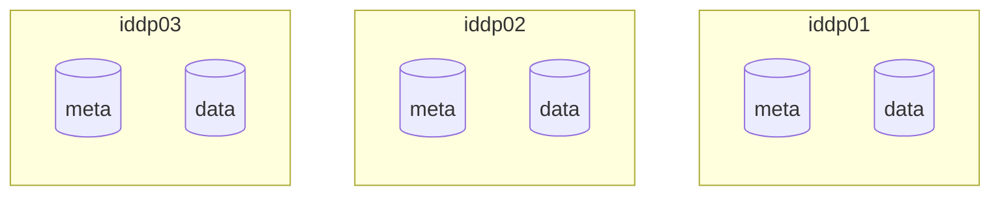
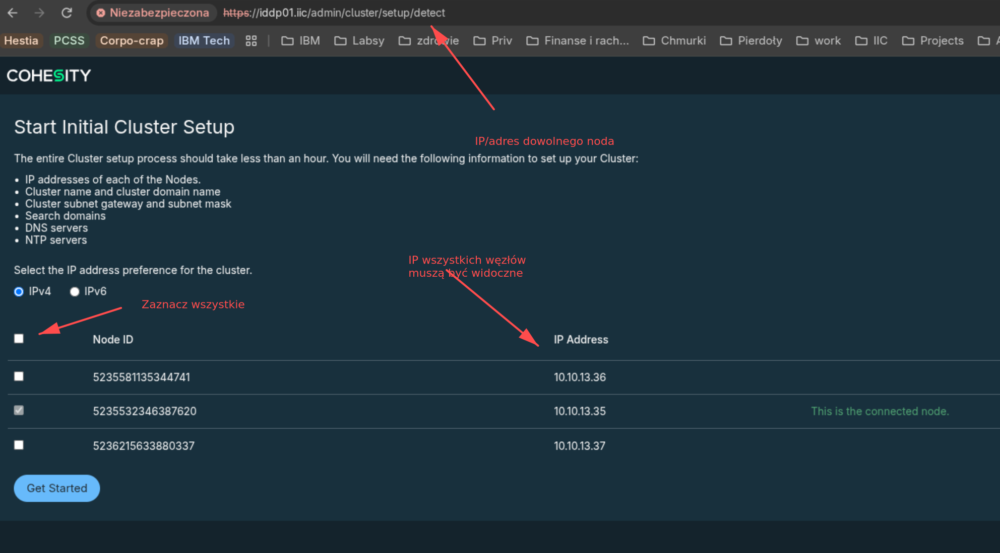
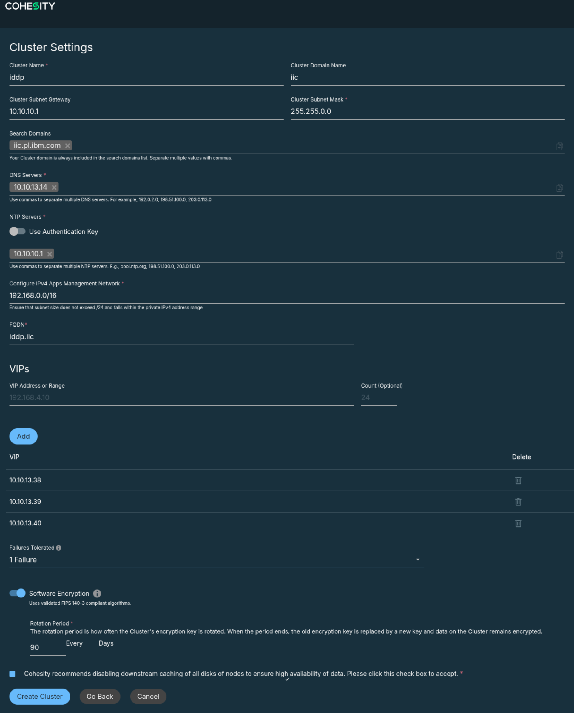

# Konfiguracja IBM Defender Data Protect 

...czyli Cohesity.

## Załżenia

- Deployment na VMware.
- 3 węzły
- Backup VMware
- Może kiedyś offload po S3 do Protecta

!!! Waning "Uwaga:"
    Nie mam pojęcia co z licencją. Jak rozgryzę to napiszę.

## Deployment OVA

Potrzebne rzeczy:

| Co?               | Wartość    | Opis |
| :--               | :--        | :--- |
| Node 1 hostname   | iddp01.iic |  |
| Node 1 hostname   | iddp01.iic |  |
| Node 1 hostname   | iddp01.iic |  |
| Cluster hostname  | iddp.iic   | Musi rozwiązywać się do wszystkich adresów VIP |
| iddp01 IP         | 10.10.13.  | boot adres |
| Pula adresów VIP  | 
| GW                |
| DNS
| NTP 

### Dyski

OVF tego nie robi, ale przed inicjalizacją klastra, trzeba do każdej maszyny dodać __dwa__ dyski: Mniejszy, szybszy na metadane w zakresie o 256GiB go 1 TiB i większy od 512GiB do 8TiB. W przypadku VMware mają to być __dokładnie dwa dyski__.

## Tworzenie klastra

!!! Tip "Wskazówka"

    Przy deploymencie na VMware trzeba włączyć tryb promiscous dla maszyn IDDP. które mają być w klastrze. W przeciwnym wypadku nie zobaczą się co łatwo sprawdzić: Na ekranie wybotu węzłów nie będzie widać adresów IP sąsiadów. 
    [Tutaj]() jest artykuł VMware, ajk to zrobić.

    Dobrym pomysłem jest utowrzenie portgrupy dla węzłów klastra i włączenie promiscous mode tylko na niej.

1. Wejdź na adres dowolnego noda i zaloguj się na `admin/admin`. Upewnij się, że widać IP sąsiednich nodów.

    

    Nciśnij _Get Started_.

1. Wypełnij formularz informacjami z tabelki powyżej:

    